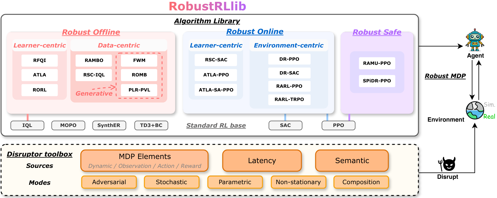

<p align="center">
  <a href="https://robustrl-lib.github.io/"></a>
</p>

<h1 align="center">RobustRLlib</h1>

<p align="center">
  <b>A Unified Library and Benchmark for Robust Reinforcement Learning Algorithms</b>
</p>

<p align="center">
  <a href="https://robustrl-lib.github.io/"></a>
  <a href="https://robustrl-lib.github.io/docs/"></a>
  
  
  
  <a href="LICENSE"></a>
</p>

<p align="center">
  
</p>

RobustRLlib is a unified library and benchmark for robust reinforcement learning: sixteen robust
online, offline and safe methods behind one interface, six standard methods for reference, and a
shift toolbox that declares a distribution shift as data and stacks any number of them on an
environment. The [tutorial](https://robustrl-lib.github.io/docs/) on the project page is the
documentation of this repository; this file gives the overview, the layout and the first commands.

| | |
|---|---|
| **22 algorithms** | 16 robust methods (online, offline and safe) and 6 standard references |
| **6 shift sources** | dynamic, observation, action, reward/cost, latency, semantic |
| **5 shift modes** | stochastic, adversarial, parametric, non-stationary, composition |
| **6 task families** | locomotion, manipulation, navigation, vehicle control, humanoid, vision–language–action |
| **273 configurations** | the shift configurations of the benchmark |

---

## 📑 Contents

- [Algorithms](#-algorithms)
- [Shift toolbox](#-shift-toolbox)
- [Layout](#-layout)
- [Install](#-install)
- [A shifted environment](#-a-shifted-environment)
- [A method on a task](#-a-method-on-a-task)
- [Tutorial](#-tutorial)
- [Licence](#-licence)

---

## 🧠 Algorithms

The robust methods are grouped by data regime and by where robustness enters: the learner, the
environment it collects from, or the data it learns from.

| Group | Family | Methods |
|---|---|---|
| Standard | reference algorithms | IQL, TD3+BC, MOPO, SynthER (offline) · PPO, SAC (online) |
| Robust online | learner-centric | ATLA, ATLA-SA, RSC |
| | environment-centric | RARL (PPO, TRPO), DR |
| Robust offline | learner-centric | RFQI, RORL, ATLA-IQL |
| | data-centric | RSC-IQL, RAMBO |
| | data-centric (generative model) | ROMB, FWM, PLR-PVL |
| Robust safe | | RAMU, SPiDR |

One page per method (mechanism, configuration cards, results by task) is in the
[algorithm pages](https://robustrl-lib.github.io/docs/algorithms/).

## 🌪️ Shift toolbox

A shift has a **source**, which says what is perturbed, and a **mode**, which says how the intervention
is built: stochastic, adversarial, parametric, non-stationary through a schedule, or a composition of
several shifts. A shifted environment is a base task with one wrapper per shift; the task code is not
modified. See [shift sources and modes](https://robustrl-lib.github.io/docs/shifts/).

## 🗂️ Layout

| Path | Content |
|---|---|
| `robustrllib/` | the library: `ShiftSpec` (`spec.py`), `make_robust` / `build_pipeline` (`pipeline.py`), one wrapper per shift (`shifts/`), schedules, simulator adapters (`adapters/`), `make_env` for task cards (`tasks.py`), the `Algo` interface (`algos/`), `metrics.py` |
| `robustrllib/gym/` | the environment API and the benchmark's environments (a fork of Gymnasium) |
| `robustrllib/configs/` | the cards: `algorithm/`, `task/`, `eval/`, `experiment/` (one per cell of the paper), `train_shifts.yaml` |
| `baselines/` | one directory per method, `train.py` and `evaluate.py` |
| `isaac/` | Part 4 on Isaac Lab: Unitree G1 and Franka drawer with PPO, DR-PPO, ATLA-PPO, RAMU-PPO and SPiDR-PPO |
| `vla/` | Part 4: the shift evaluation of a fine-tuned π0.5 policy |
| `examples/` | `mujoco_quickstart.py`, `reinforce_hopper.yaml` (a custom algorithm) |
| `tests/` | `pytest tests/robust` exercises the shift toolbox and the cards |

## 🛠️ Install

```bash
pip install -e ".[all]"        # or pick: mujoco, box2d, robosuite, methods
```

The offline methods read the Minari releases of the D4RL datasets; LunarLander's dataset is
generated once with `python baselines/offline/lunarlander.py --out datasets/lunarlander_medium.npz`.

## 🚀 A shifted environment

```python
from robustrllib import make_robust, ShiftSpec

env = make_robust("Hopper-v5", shifts=[
    ShiftSpec("dynamics", "scale", {"param": "gravity", "factor": 1.3}),
    ShiftSpec("observation", "gauss", {"sigma": 0.05}),
], seed=0)
obs, info = env.reset(seed=0)
```

## 🏋️ A method on a task

Every cell of the paper is one experiment card, `robustrllib/configs/experiment/<method>_<task>.yaml`:

```bash
python baselines/train.py -c robustrllib/configs/experiment/rarl_ppo_hopper.yaml --seed 0
python baselines/evaluate.py --run runs/rarl_ppo_hopper/seed0
```

| Part of the paper | Command |
|---|---|
| 1, library-wide grid | train each card, evaluate on its own grid (`eval/part1_<task>.yaml`) |
| 2, frozen-policy channels | evaluate a Hopper run with `--eval robustrllib/configs/eval/part2_hopper.yaml` |
| 2, training-time channels | train a Hopper card with `--train-shift reward_gauss` (or another arm of `train_shifts.yaml`), evaluate with `--eval robustrllib/configs/eval/nominal.yaml` |
| 2, semantic channel | train and evaluate the `*_doorcausal.yaml` cards |
| 3, compound shifts | evaluate a Hopper run with `--eval robustrllib/configs/eval/part3_hopper.yaml`; train and evaluate the `*_pusher*.yaml` cards |
| 4 | `isaac/README.md`, `vla/README.md` |

## 📖 Tutorial

The [tutorial](https://robustrl-lib.github.io/docs/) covers installation, training an algorithm, adding a
new algorithm, the shift sources and modes, adding a shift factor or a physics simulation, and the
evaluation protocol.

## 📄 Licence

MIT (`LICENSE`). Code derived from other projects keeps its own licence; see
`THIRD_PARTY_NOTICES.md`.
