<p align="center">
  <a href="https://robustrl-lib.github.io/"></a>
</p>

<h1 align="center">RobustRLlib</h1>

<p align="center">
  <b>A Unified Library and Benchmark for Robust Reinforcement Learning Algorithms</b>
</p>

<p align="center">
  <a href="https://robustrl-lib.github.io/"></a>
  <a href="https://robustrl-lib.github.io/docs/"></a>
  
  
  
  <a href="LICENSE"></a>
</p>

<p align="center">
  
</p>

RobustRLlib is a unified library and benchmark for robust reinforcement learning: sixteen robust
online, offline and safe methods behind one interface, six standard methods for reference, and a
shift toolbox that declares a distribution shift as data and stacks any number of them on an
environment. The [tutorial](https://robustrl-lib.github.io/docs/) on the project page is the
documentation of this repository; this file gives the overview, the layout and the first commands.

| | |
|---|---|
| **22 algorithms** | 16 robust methods (online, offline and safe) and 6 standard references |
| **6 shift sources** | dynamic, observation, action, reward/cost, latency, semantic |
| **5 shift modes** | stochastic, adversarial, parametric, non-stationary, composition |
| **6 task families** | locomotion, manipulation, navigation, vehicle control, humanoid, vision–language–action |
| **273 configurations** | the shift configurations of the benchmark |

---

## 📑 Contents

- [How it works](#-how-it-works)
- [Algorithms](#-algorithms)
- [Shift toolbox](#-shift-toolbox)
- [Layout](#-layout)
- [Install](#-install)
- [Shifts, training and evaluation](#-shifts-training-and-evaluation)
- [Task support](#-task-support)
- [Tutorial](#-tutorial)
- [Licence](#-licence)

---

## 🧩 How it works

<p align="center">
  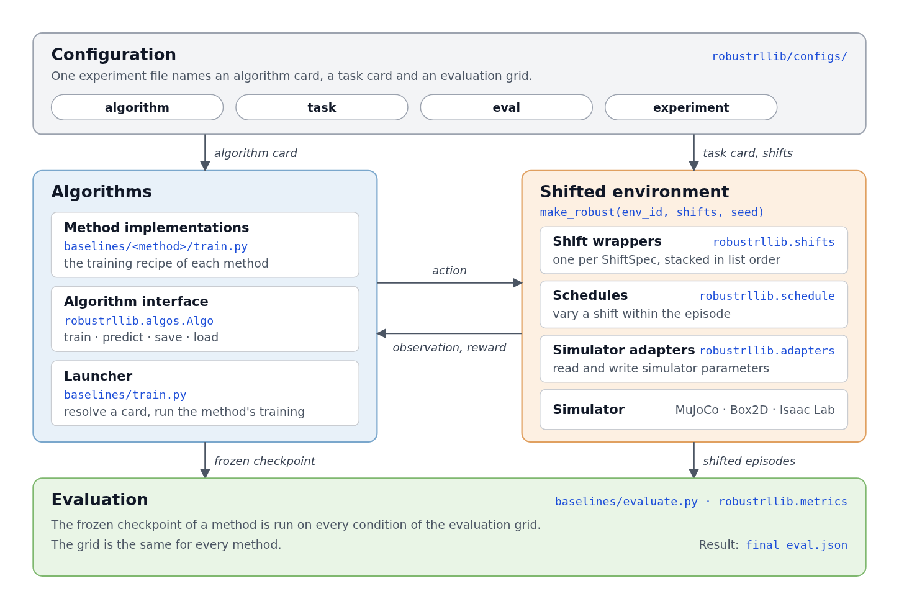
</p>

**Three parts.** Configuration cards name an algorithm, a task and an evaluation grid; the algorithm trains on the task with its own recipe while `make_robust` stacks the declared shifts on the environment; the evaluator runs the frozen checkpoint on every condition of the grid and writes one result file.

## 🧠 Algorithms

The robust methods are grouped by data regime and by where robustness enters: the learner, the
environment it collects from, or the data it learns from.

| Group | Family | Methods |
|---|---|---|
| Standard | reference algorithms | IQL, TD3+BC, MOPO, SynthER (offline) · PPO, SAC (online) |
| Robust online | learner-centric | ATLA, ATLA-SA, RSC |
| | environment-centric | RARL (PPO, TRPO), DR |
| Robust offline | learner-centric | RFQI, RORL, ATLA-IQL |
| | data-centric | RSC-IQL, RAMBO |
| | data-centric (generative model) | ROMB, FWM, PLR-PVL |
| Robust safe | | RAMU, SPiDR |

One page per method (mechanism, configuration cards, results by task) is in the
[algorithm pages](https://robustrl-lib.github.io/docs/algorithms/).

## 🌪️ Shift toolbox

A shift has a **source**, which says what is perturbed, and a **mode**, which says how the intervention
is built: stochastic, adversarial, parametric, non-stationary through a schedule, or a composition of
several shifts. A shifted environment is a base task with one wrapper per shift; the task code is not
modified. See [shift sources and modes](https://robustrl-lib.github.io/docs/shifts/).

## 🗂️ Layout

| Path | Content |
|---|---|
| `robustrllib/` | the library: `ShiftSpec` (`spec.py`), `make_robust` / `build_pipeline` (`pipeline.py`), one wrapper per shift (`shifts/`), schedules, simulator adapters (`adapters/`), `make_env` for task cards (`tasks.py`), the `Algo` interface (`algos/`), `metrics.py` |
| `robustrllib/gym/` | the environment API and the benchmark's environments (a fork of Gymnasium) |
| `robustrllib/configs/` | the cards: `algorithm/`, `task/`, `eval/`, `experiment/` (one per cell of the paper), `train_shifts.yaml` |
| `baselines/` | one directory per method, `train.py` and `evaluate.py` |
| `isaac/` | Part 4 on Isaac Lab: Unitree G1 and Franka drawer with PPO, DR-PPO, ATLA-PPO, RAMU-PPO and SPiDR-PPO |
| `vla/` | Part 4: the shift evaluation of a fine-tuned π0.5 policy |
| `examples/` | `mujoco_quickstart.py`, `reinforce_hopper.yaml` (a custom algorithm) |
| `tests/` | `pytest tests/robust` exercises the shift toolbox and the cards |

## 🛠️ Install

```bash
pip install -e ".[all]"        # or pick: mujoco, box2d, robosuite, methods
```

The offline methods read the Minari releases of the D4RL datasets; LunarLander's dataset is
generated once with `python baselines/offline/lunarlander.py --out datasets/lunarlander_medium.npz`.

## 🧪 Shifts, training and evaluation

**1. Shifts on a task.** A shift is a `ShiftSpec(target, mode, params)`; a shifted environment is a task with a list of
them, stacked in list order. Targets are `dynamics`, `observation`, `action`, `reward`, `cost`, `latency`, `transition`
and `appearance`; the modes for each are listed in `robustrllib/spec.py`.

```python
from robustrllib import make_robust, ShiftSpec

# Hopper (MuJoCo): heavier gravity, slippery feet, noisy observations
env = make_robust("Hopper-v5", shifts=[
    ShiftSpec("dynamics", "scale", {"param": "gravity", "factor": 1.3}),         # dynamic shift
    ShiftSpec("dynamics", "scale", {"param": "geom_friction", "factor": 0.5}),   # dynamic shift
    ShiftSpec("observation", "gauss", {"sigma": 0.05}),                           # observation shift
], seed=0)

# Walker2d: actuator noise and a control delay of one to two steps
env = make_robust("Walker2d-v5", shifts=[
    ShiftSpec("action", "gauss", {"sigma": 0.06}),                                # action shift
    ShiftSpec("latency", "buffer", {"low": 1, "high": 2}),                        # latency shift
], seed=0)

# Observation noise that grows linearly over the first 100k steps (non-stationary), on top of a noisy reward
env = make_robust("Hopper-v5", shifts=[
    ShiftSpec("observation", "gauss", {"sigma": 0.1},
              schedule={"type": "linear", "start": 0.0, "end": 1.0, "t0": 0, "t1": 100_000}),
    ShiftSpec("reward", "gauss", {"sigma": 0.5}),                                 # reward shift
], seed=0)

# LunarLander (Box2D): stronger gravity
env = make_robust("LunarLanderContinuous-v3", shifts=[
    ShiftSpec("dynamics", "scale", {"param": "gravity", "factor": 1.2}),
], seed=0)
```

**2. Train an algorithm on a task.** An experiment card names one algorithm and one task:
`robustrllib/configs/experiment/<method>_<task>.yaml`.

```bash
python baselines/train.py -c robustrllib/configs/experiment/sac_walker2d.yaml --seed 0

# train under a shift: an arm of robustrllib/configs/train_shifts.yaml acts on the learning signal
python baselines/train.py -c robustrllib/configs/experiment/ppo_hopper.yaml --seed 0 --train-shift reward_gauss

# override any key of the run configuration, e.g. a shorter budget
python baselines/train.py -c robustrllib/configs/experiment/ppo_hopper.yaml --seed 0 --set train.steps=200000
```

**3. Evaluate under your own shifts.** List the conditions in a card; each condition is a list of shifts, and every
condition is scored on the same episodes.

```yaml
# my_eval.yaml
episodes: 20
seed: 10000
grid:
- name: nominal
  shifts: []
- name: heavy_gravity
  shifts:
  - {target: dynamics, mode: scale, params: {param: gravity, factor: 1.3}}
- name: noisy_and_late
  shifts:
  - {target: observation, mode: gauss, params: {sigma: 0.05}}
  - {target: latency, mode: buffer, params: {low: 1, high: 2}}
```

```bash
python baselines/evaluate.py --run runs/sac_walker2d/seed0 --eval my_eval.yaml
# writes runs/sac_walker2d/seed0/eval/my_eval.json: the return and the normalized score of each condition
```

## 🗺️ Task support

RobustRLlib covers **six task families with 14 tasks**, simulated in MuJoCo, Box2D, robosuite and Isaac Lab, plus a
vision–language–action policy evaluated on bimanual arms. Every task offers the dynamic, observation, action and latency
shifts, every task but the VLA one the reward/cost shift, and DoorCausal, the two Isaac Lab tasks and the VLA task the
semantic shift.

| Family | Tasks | Simulator |
|---|---|---|
| Locomotion | Hopper-v5 · Walker2d-v5 · HalfCheetah-v5 | MuJoCo |
| Manipulation | Pusher-v5s · FetchReachDense-v3 · AdroitHandDoor-v1 · DoorCausal · Drawer opening | MuJoCo · robosuite · Isaac Lab |
| Navigation | PointMaze_UMaze-v3 · PointMaze_Open-v3 | MuJoCo |
| Vehicle control | LunarLanderContinuous-v3 · CarRacing-v2 | Box2D |
| Humanoid | Unitree G1 locomotion | Isaac Lab |
| Vision–language–action | Insert mouse battery (π0.5) | bimanual arms (evaluation) |

Click a clip to open the full video. More on the [project page](https://robustrl-lib.github.io/).

<table>
  <tr>
    <td align="center" width="33%">
      <a href="https://robustrl-lib.github.io/assets/tasks/hopper.mp4">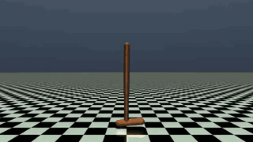</a><br>
      <sub><b>Hopper-v5</b><br>Locomotion</sub>
    </td>
    <td align="center" width="33%">
      <a href="https://robustrl-lib.github.io/assets/tasks/walker2d.mp4">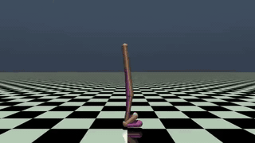</a><br>
      <sub><b>Walker2d-v5</b><br>Locomotion</sub>
    </td>
    <td align="center" width="33%">
      <a href="https://robustrl-lib.github.io/assets/tasks/halfcheetah.mp4">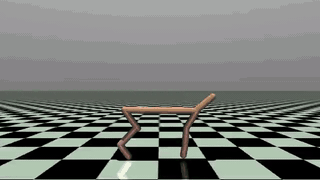</a><br>
      <sub><b>HalfCheetah-v5</b><br>Locomotion</sub>
    </td>
  </tr>
  <tr>
    <td align="center" width="33%">
      <a href="https://robustrl-lib.github.io/assets/tasks/pusher.mp4">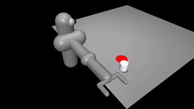</a><br>
      <sub><b>Pusher-v5s</b><br>Manipulation</sub>
    </td>
    <td align="center" width="33%">
      <a href="https://robustrl-lib.github.io/assets/tasks/door.mp4">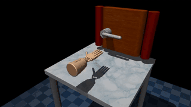</a><br>
      <sub><b>AdroitHandDoor-v1</b><br>Manipulation</sub>
    </td>
    <td align="center" width="33%">
      <a href="https://robustrl-lib.github.io/assets/tasks/fetchreach.mp4">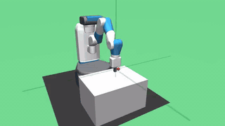</a><br>
      <sub><b>FetchReachDense-v3</b><br>Manipulation</sub>
    </td>
  </tr>
  <tr>
    <td align="center" width="33%">
      <a href="https://robustrl-lib.github.io/assets/tasks/pointmaze.mp4">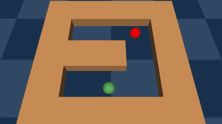</a><br>
      <sub><b>PointMaze_UMaze-v3</b><br>Navigation</sub>
    </td>
    <td align="center" width="33%">
      <a href="https://robustrl-lib.github.io/assets/tasks/lunarlander.mp4">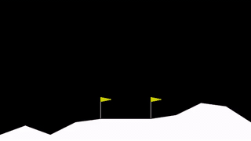</a><br>
      <sub><b>LunarLanderContinuous-v3</b><br>Vehicle control</sub>
    </td>
    <td align="center" width="33%">
      <a href="https://robustrl-lib.github.io/assets/tasks/carracing.mp4">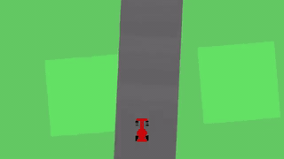</a><br>
      <sub><b>CarRacing-v2</b><br>Vehicle control</sub>
    </td>
  </tr>
  <tr>
    <td align="center" width="33%">
      <a href="https://robustrl-lib.github.io/assets/tasks/g1.mp4">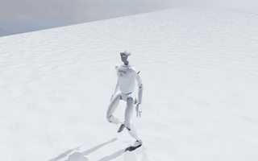</a><br>
      <sub><b>Unitree G1 locomotion</b><br>Humanoid · Isaac Lab</sub>
    </td>
    <td align="center" width="33%">
      <a href="https://robustrl-lib.github.io/assets/tasks/drawer.mp4">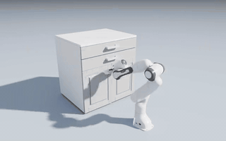</a><br>
      <sub><b>Drawer opening</b><br>Manipulation · Isaac Lab</sub>
    </td>
    <td align="center" width="33%">
      <a href="https://robustrl-lib.github.io/assets/tasks/vla.mp4">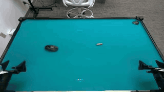</a><br>
      <sub><b>Insert mouse battery (π0.5)</b><br>Vision–language–action</sub>
    </td>
  </tr>
</table>

## 📖 Tutorial

The [tutorial](https://robustrl-lib.github.io/docs/) covers installation, training an algorithm, adding a
new algorithm, the shift sources and modes, adding a shift factor or a physics simulation, and the
evaluation protocol.

## 📄 Licence

MIT (`LICENSE`). Code derived from other projects keeps its own licence; see
`THIRD_PARTY_NOTICES.md`.
